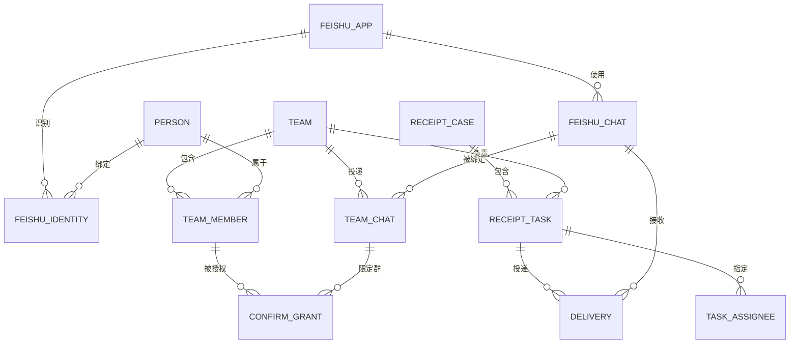

# 飞书应用、群、确认人与团队的数据模型

状态：已被 [飞书群个人回执](feishu-individual-receipts.md) 取代；本文保留早期白名单设计  
范围：Vulnfeed 飞书应用配置、确认权限、消息投递和确认单关联

## 1. 现有模型的问题

- `feishu_app_settings` 强制只有一个应用，同时保存一个默认群；它混合了应用凭证与消息目标。
- `receipt_team_chat` 在每个团队下重复保存群名称和 Chat ID。同一个飞书群被多个团队使用时，群信息会重复且可能不一致，也没有明确的应用归属。
- `receipt_team_member` 将团队成员、飞书应用身份和显示名称合并。同一人属于多个团队时出现多条用户记录；应用更换后原有 Open ID 不能直接沿用。
- `receipt_member_chat` 绑定的是团队内的群记录，但缺少清晰的“谁可以在哪个应用、哪个群、代表哪个团队确认”的统一授权模型。
- 投递记录保留了应用和群的原始字符串，却缺少可追踪的应用、群实体；改名、停用或更换应用后，不便区分当前配置和历史消息。

因此需要把飞书资源和业务组织拆开，再通过关联表表达投递及确认权限。应用、群和人员身份不能仅靠显示名称关联。

## 2. 核心关系

关系说明：

1. 一个飞书应用对应一套应用凭证和租户，应用可以配置多个群及多个飞书用户身份。一个群可以由多个应用分别访问，实际能否发消息由飞书权限和机器人入群状态决定。
2. 一个人可属于多个团队，也可绑定多个应用身份。同一应用中的 `open_id` 仅标识该应用下的用户；不同应用的 `open_id` 不能假设相同。跨应用身份归属于同一人必须由管理员明确绑定或经可靠身份映射确认，不能按姓名自动合并。
3. 一个团队可绑定多个群；同一群可绑定多个团队。团队与群的关联只决定投递目的地，不自动授予群成员确认权限。
4. 每个团队成员可被授予在该团队的一个或多个绑定群中确认。授权限定到“团队成员 + 团队群关联”，即使两团队共用一个群，授权也互不继承。实际飞书用户必须有该群对应应用的身份。
5. 一张确认单针对每个团队生成一个任务；该团队任务可向多个群发送卡片。默认团队内任一获授权的任务确认人提交一次即代表团队确认，而不是每个群都必须分别确认。

用户确认的关系：**一个飞书应用可以关联多个确认人和多个群；一个确认人可以关联多个飞书应用和多个群**。因此应用与确认人、确认人与群都是多对多关系，群可由多个应用分别接入。确认人跨应用的 Open ID 分别保存；“确认人关联某个群”仍需指明应用和其代表的团队，才构成有效的回执授权。

## 3. 实体和约束

| 实体 | 字段与约束 | 用途 |
| --- | --- | --- |
| `feishu_app` | `id`、`name`、`app_id`（唯一）、`tenant_key`、`secret_ref`、`enabled`、配置版本、时间戳 | 飞书企业自建应用。密钥通过服务端密钥存储引用管理，不返回给普通管理 API。首版可先启用一个应用，但关系不依赖单例。 |
| `feishu_chat` | `id`、`app_id`（内部外键）、`tenant_key`、`chat_id`、`name`、`enabled`；`(app_id, tenant_key, chat_id)` 唯一 | 一个应用视角下的群；名称可更新，Chat ID 是平台标识。应用和群的组合标识消息投递通道。 |
| `person` | `id`、`name`、`enabled`、时间戳 | Vulnfeed 中的确认人。姓名用于显示，不用于身份认证。 |
| `feishu_identity` | `id`、`person_id`、`app_id`、`tenant_key`、`open_id`、`enabled`；`(app_id, tenant_key, open_id)` 唯一 | 将飞书身份绑定到人。允许同一人有多个应用身份；`app_id` 与租户要与应用一致。 |
| `team` | `id`、`name`、`enabled`、时间戳 | 业务责任团队。 |
| `team_member` | `id`、`team_id`、`person_id`、`enabled`；`(team_id, person_id)` 唯一 | 人与团队的成员关系。 |
| `team_chat` | `id`、`team_id`、`feishu_chat_id`、`enabled`；`(team_id, feishu_chat_id)` 唯一 | 一个团队的消息投递群。 |
| `confirm_grant` | `id`、`team_member_id`、`team_chat_id`、`enabled`；`(team_member_id, team_chat_id)` 唯一 | 指定该团队成员可在哪个团队群代表团队确认；必须保证两端属于同一个团队，且成员拥有该群应用下的有效身份。 |
| `receipt_case` / `receipt_task` | 来源类型、来源 ID、确认单状态；任务唯一键 `(case_id, team_id)` | 一条来源可发起确认，团队之间分别判断。任务记录团队名称快照。 |
| `task_assignee` | `task_id`、`team_member_id`、指定/撤销时间；任务中有效人员唯一 | 发起时指定的确认人快照，管理员显式调整并审计；不因新增成员自动扩大。 |
| `delivery` | `task_id`、`team_chat_id`、应用/租户/群 ID 快照、`message_id`、请求幂等 ID、状态、错误、版本；按任务、群、版本唯一 | 记录每个群发送情况。历史消息定位使用发送时快照，不因后续改名或换绑改变。 |
| `receipt_event` | 任务、投递、应用、租户、操作者身份、平台事件 ID、前后状态、内容与时间 | 回执审计；平台事件 ID 按应用及租户去重。 |

所有外键应启用 SQLite 外键检查；通过事务和复合外键或触发器保证 `confirm_grant` 两侧团队一致、身份应用与群应用匹配。数据库约束与服务端校验同时执行。配置上优先停用，不硬删除被历史单据引用的应用、群、团队、人员或关联关系。

## 4. 确认授权

收到经飞书长连接认证的卡片回调后，服务端逐项核验：

1. 根据应用 ID、租户、消息 ID 和 Chat ID 找到原始投递记录及其任务；拒绝不匹配的群、应用、租户、消息、任务或已关闭单据。
2. 根据该应用及租户下的操作者 Open ID 找到有效 `feishu_identity` 和 `person`，检查应用、身份、人员均启用。
3. 检查操作人是该团队有效成员，且是任务指定确认人；检查该成员对投递对应的团队群有有效 `confirm_grant`，同时团队和群绑定仍启用。
4. 检查任务状态、版本及幂等键，在同一事务内写入确认结论、影响说明、操作者与投递快照，并排队同步其他群卡片。

权限撤销、人员停用、群解绑或应用停用后立即拒绝新提交；已提交回执与审计记录保留。权限扩大不自动改变已有任务的指定人员：管理员须明确调整任务人员。修改群名称不改变群身份；更换 Chat ID 应视为绑定新群并停用旧群，历史卡片继续关联旧快照，不能直接改写已投递消息的归属。

## 5. 页面与使用流程

1. **飞书应用**：新增/编辑应用名称、App ID、App Secret 和可选的 Tenant Key，测试连接；密钥写入后不回显。应用切换或停用时提示未完成任务和待更新卡片。
2. **飞书群**：选择应用，填写群名称和 Chat ID；同一群可关联多个团队。提供连接测试与飞书实际权限检查，但手工配置的名称不代表已入群。
3. **确认人**：维护人员姓名及应用身份 Open ID；同一人可绑定多个应用身份。可选通讯录选择，但须事先申请对应权限；手工输入仍需能校验或标记“未验证”。
4. **团队**：维护团队及成员，选择一个或多个群；对每个成员勾选可以确认的团队群。界面明确显示未绑定该群应用身份、未获授权或无有效确认人的情况。
5. **确认单**：显示各团队、各群投递状态、指定确认人和实际回执。发送前逐群验证至少有一名当前有效且被任务指定的确认人；异常群明确显示失败，不静默漏发。

## 6. 数据库切换方案

按用户确认，本次使用全新数据库，不迁移旧配置或历史回执。切换前停止服务并移除旧数据库，再启动服务初始化新表；切换后需要重新配置应用、人员、群和授权。只有在新模型的管理、投递、回调和长连接均接通并通过验证后才能执行切换。

## 7. 验收

- 同一应用的两个群绑定一个团队：只有该团队被授权的确认人在对应群可提交；没有群授权、没有应用身份或不是任务确认人的人员均拒绝。
- 同一群绑定两个团队：对 A 团队有权限不代表可确认 B；每个团队任务独立。
- 同一人两个团队、两个应用：分别映射应用身份；错误应用的 Open ID 无法操作。应用切换不自动沿用旧 Open ID。
- 群改名、解绑、人员停用、权限撤销、任务指定人员调整：新权限立即生效，历史记录保留。
- 并发与重复回调仅产生一次状态变更；部分群投递失败可见且可重试，不阻止其他群；多群卡片最终显示同一任务状态。
- 迁移前后逐项核对团队、人员、授权、任务及投递；冲突和未匹配记录进入人工核对，不扩大权限。

## 8. 需要确定的产品规则

默认建议是：同一团队一个任务，多个群只是不同通知入口，任一指定确认人确认即可。如果需要每个群或每位负责人都单独确认，则需要改变任务粒度与关闭条件，不能仅修改权限表。还需决定首版是否需要同时启用多个飞书应用，以及人员/群信息采用手工维护还是接入通讯录同步。
