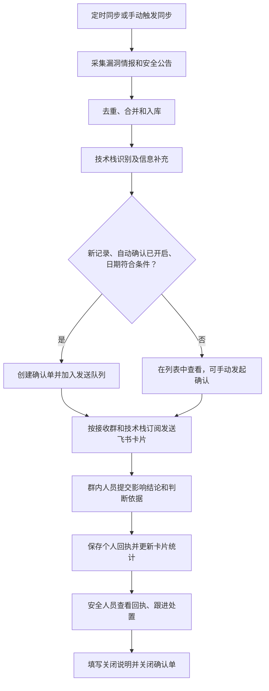

# 漏洞披露处理流程

本文依据当前 Vulnfeed 代码整理，适用于漏洞情报和厂商安全公告。它描述系统已经实现的处理流程，也标明需要人工完成的环节；实际运行情况取决于同步任务、飞书应用和接收群的配置。

## 一、流程总览

## 二、准备工作

1. 在同步任务中配置同步间隔并启用任务；需要自动发确认函时，开启「自动发起影响确认」。也可以在页面手动触发一次同步。
2. 在飞书应用配置中填写应用名称、App ID 和 App Secret，并启用应用；将应用添加到需要接收确认函的群。在接收群配置中添加群名称和 Chat ID，并启用对应群。
3. 按需配置技术栈词典及接收群的技术栈订阅。不选择订阅表示接收全部；选择订阅后，仅接收技术栈有交集的记录，未识别出技术栈的记录只发送给接收全部的群。群也可配置需要 @ 的人员。
4. 如需自动显示填写人的姓名、所属部门，需要应用具备相应的飞书通讯录访问权限及可见范围；姓名或部门查询失败时，页面可能显示 Open ID 或缺少部门信息，并在后台重试。
5. 飞书卡片交互需要应用的事件订阅和卡片回调正确配置，且 Vulnfeed 与飞书长连接桥接服务正常运行。内网部署可以通过应用主动建立的长连接接收交互事件。

## 三、采集与入库

调度器按配置的时间间隔执行，也支持页面手动触发。各漏洞来源插件和安全公告插件并发采集，一项插件失败会记录错误，其他插件仍可继续。

漏洞记录依据来源标识去重；同一 CVE 来自不同来源时，系统可将来源信息合并到已有记录。安全公告依据来源标识判断是否已存在。对带 CVE 的新漏洞，系统还会尝试查询 GitHub 相关信息；查询失败不应被视为漏洞不存在。

启用技术栈词典后，系统使用关键词对新入库记录打标签；如果配置并启用大模型分类，则尝试使用模型结果，调用失败时保留关键词结果。技术栈识别是路由辅助，不能代替资产排查或影响判断。

## 四、发起影响确认

### 自动发起

同时满足以下条件时，新入库记录会自动创建确认单：

- 同步任务启用了「自动发起影响确认」。
- 对应漏洞或公告是新记录，且同一来源记录尚无确认单。
- 披露或发布时间可以识别，且按服务所在时区判断为当天或以后。

早于当天或无法识别日期的记录不会自动发起确认，可由管理员手动发起。自动确认始终使用上述日期条件，不因「允许自动推送历史数据」开关开启而放宽。

确认单及其自动发送任务写入数据库后，后台按接收群订阅投递飞书卡片。发送失败会保留任务并重试；已有卡片会被复用或更新。已撤回的卡片可在确认单中重新发送。若没有启用的接收群，发送会失败并等待重试；若存在启用群但没有群匹配技术栈订阅，则不会向这些群发送，需检查订阅配置。

### 手动发起

在「漏洞列表」或「安全公告」找到对应记录，点击影响确认按钮。历史记录也可以手动发起。已有进行中的确认单会被复用；在确认单详情中可以再次发送确认卡片，查看各群发送状态和回执。

## 五、群内填写与汇总

飞书卡片展示漏洞或公告信息，并提供以下影响结论：

| 结论 | 填写要求 | 业务含义 |
| --- | --- | --- |
| 待排查 | 判断依据可留空 | 尚未完成影响判断，需后续继续跟进。 |
| 无影响 | 必须填写判断依据，最多 50 字 | 已排查并认为本方不受影响。 |
| 有影响 | 必须填写判断依据或影响范围，最多 50 字 | 已确认存在影响，需进一步处置。 |

系统从飞书交互事件取得填写人身份，无需预先维护确认人名单。能够操作已发送卡片的用户可提交；服务端校验应用、租户、群、原消息和确认单状态，但不会独立向飞书核验操作者当前是否仍在群内，因此应控制接收群访问范围。

同一用户可再次提交以覆盖自己的结论。同步任务可配置是否允许填写人删除自己的回执；管理员也可在网页修改或删除回执。不同飞书应用中的 Open ID 不会自动合并为同一人。

卡片展示各结论人数和最近 20 条回执，更多记录可在网页确认单详情查看并导出 CSV。卡片更新失败时后台重试。姓名和部门解析依赖飞书权限与可见范围，不能以页面出现 Open ID 或部门为空就认定回执无效。

## 六、跟进、催办与关闭

安全人员在确认单详情查看个人结论、说明和发送状态，联系相关负责人核实影响范围，并在组织内部完成修复、缓解或风险接受等处置。卡片中的 50 字说明适合记录简要依据，详细资产清单、工单、修复证据和验证记录需要在外部系统或另行沟通中维护。

「自动催办未回执」可在同步任务中开启。当前实现依赖群成员缓存识别未回执人员，每个任务最多发送 3 次，成功发送的两次催办间隔至少 24 小时，后台约每 30 分钟检查一次。群成员未同步时，系统无法生成具体未回执人员名单，实际发送可能无法完成；需要检查群成员读取权限和缓存状态，不能仅凭开启开关就认定催办已经发出。

完成处置和必要的人工复核后，管理员在确认单详情填写关闭说明并关闭。关闭后不能继续提交或修改回执。系统当前允许管理员决定关闭时机，不会强制所有人回执、验证修复或自动创建处置工单；这些要求需要由组织的处理规范落实。

## 七、常见异常排查

| 现象 | 检查方向 |
| --- | --- |
| 同步后没有确认单 | 检查自动确认开关、记录是否为新入库、日期是否为当天或以后且能识别；历史记录可手动发起。 |
| 有确认单但群里没有卡片 | 检查应用和群是否启用、应用是否在群内、群技术栈订阅是否匹配，以及发送失败日志和确认单中的投递状态。 |
| 卡片提示回调服务未在线 | 检查长连接桥接服务、应用事件订阅及卡片交互配置。 |
| 回执显示 Open ID 或没有部门 | 检查飞书通讯录权限、应用可见范围和后台查询状态；必要时在页面重试姓名查询。 |
| 卡片已撤回 | 在确认单详情重新发送，原有回执保留。 |
| 未收到催办 | 检查自动催办开关、群成员缓存、确认单状态、催办次数和发送日志。 |

## 八、当前边界

- 自动发送队列在确认单创建成功后提供重试；漏洞或公告入库与确认单创建不是同一个事务，若进程恰好在两者之间中断，或创建确认单时报错，现有流程不会自动补建。应检查日志，必要时手动发起。
- 当前回执以个人最新结果为主；不要将其视为完整的逐次修改审计记录。确认单关闭说明可用于记录关闭原因。
- 自动发送成功或确认单关闭不等于漏洞已经修复；是否完成处置，需要结合资产信息和人工验证判断。
- 文档描述代码能力，不代表某一环境已启用同步、完成飞书授权或已经成功投递。
